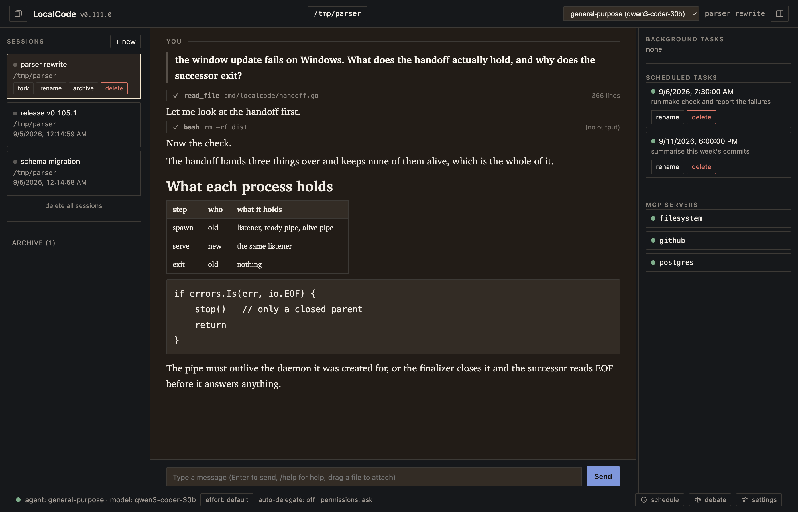
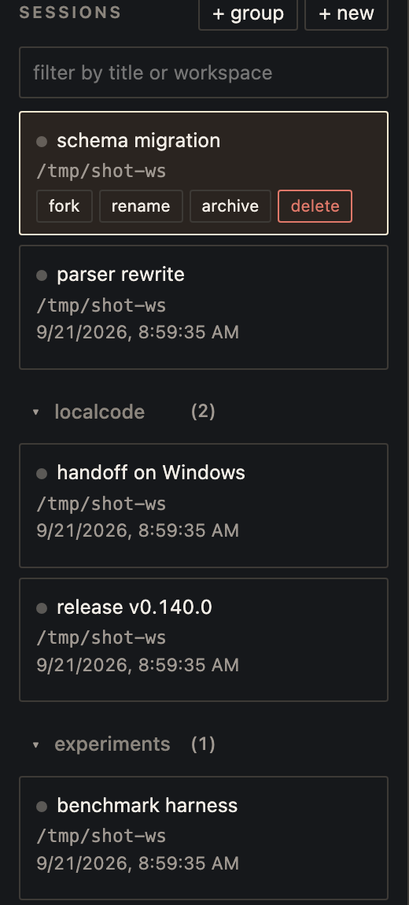

<p align="center">
  
</p>

<h1 align="center">localcode</h1>

<p align="center">
  A coding agent that runs on your machine, on any model,<br>
  and lets a second model check the first.
</p>

<p align="center">
  <a href="https://github.com/dennis2lee/localcode/releases/latest">Download</a> ·
  <a href="#install">Install</a> ·
  <a href="https://dennis2lee.github.io/localcode/where-localcode-differs.html">Where it differs</a> ·
  <a href="https://dennis2lee.github.io/localcode/coding-agent-benchmark.html">Benchmark</a> ·
  <a href="docs/USAGE.md">Manual</a>
</p>

<p align="center">
  
</p>

## Why another coding agent



Every coding agent runs one model in one loop and asks it to review its own work. localcode is built around what that loop cannot do.

**Reviewers that do not share a brain.** [`/debate`](https://dennis2lee.github.io/localcode/where-localcode-differs.html#debate) hands your change to up to three reviewers, each a separate agent on its own model, none able to see the others. Nothing ships until all of them say yes. Put Claude, a local Qwen and GPT on the panel and you get disagreement instead of a model agreeing with itself.

**Work that runs when you said, not when you sent it.** `tomorrow at 9am run the full test suite and summarise only the failures` is [booked](https://dennis2lee.github.io/localcode/where-localcode-differs.html#scheduled), the time parsed by localcode rather than guessed at by the model. Korean works too. A time that passes while localcode is closed is reported as missed, not run late.

**Plans checked before a token is spent.** [Orchestrate](https://dennis2lee.github.io/localcode/where-localcode-differs.html#orchestrate) makes a multi-agent plan structured data. Every agent named, every stage reference and every count is validated whole, and a plan that would not work is refused with the reason, not narrated and abandoned halfway.

**Any model, hosted or on your own machine, in one conversation.** Bedrock, the Anthropic API and anything OpenAI-compatible (LM Studio, vLLM, llama.cpp, Ollama), with [switching mid-conversation](https://dennis2lee.github.io/localcode/where-localcode-differs.html#model-switch). [Local runtimes](https://dennis2lee.github.io/localcode/where-localcode-differs.html#local-models) get both spellings of the reasoning field, the context window the server actually loaded, and failover to another profile.

**You can see what the model will see.** [`/context`](https://dennis2lee.github.io/localcode/where-localcode-differs.html#prompt-inventory) reports the next request piece by piece (source, trust class, token estimate) without a model call. Another conversation reaches this one only through [`#name`](https://dennis2lee.github.io/localcode/where-localcode-differs.html#reference), as a tool result the model asked for, never spliced into your prompt.

## On the same model

Twenty-five SWE-bench Verified instances, one model, four agents. Claude Code resolved 19; localcode resolved 19 with Smart Agent off and 21 with it on. That run used a version in which Smart Agent also brought the specialists and delegation that now come with Orchestrate. That spread is inside run-to-run variance, so [the benchmark](https://dennis2lee.github.io/localcode/coding-agent-benchmark.html) does not rank them. What it shows is that pointing an agent at your own model, with reviewers and schedules and validated plans on top, gives nothing up.

## It reads what you already have

`CLAUDE.md` and `AGENTS.md` with `@path` imports; skills from `.claude`, `.opencode` and `.localcode`, all merged, and commands from the first of them; your Claude Code MCP servers via `localcode mcp import-claude` or by listing `.mcp.json`; an `opencode.json` as it is, when you list it under `include`. One daemon serves a terminal client, a browser client and a native window at once. Run it on the box with the GPU, attach from a laptop.

## Install

One static binary, no root, nothing left outside `$HOME`:

```bash
curl -fsSL https://raw.githubusercontent.com/dennis2lee/localcode/main/scripts/install.sh | sh
```

The Windows MSI, the macOS `.app` and the Debian packages are on the [releases page](https://github.com/dennis2lee/localcode/releases/latest). Every other way, and each platform's first-run steps, is in [INSTALL.md](docs/INSTALL.md).

### First run

1. Write `~/.localcode/config.json` (on Windows, `%USERPROFILE%\.localcode\config.json`). It needs one provider, one profile, and `default_profile`. Use the block for the model you have.

   **Anthropic API key.** Run `localcode login anthropic` first. It saves the key and prints this file.

   ```json
   {
     "providers": { "anthropic": { "type": "anthropic" } },
     "profiles": { "main": { "provider": "anthropic", "model": "claude-sonnet-5" } },
     "default_profile": "main"
   }
   ```

   **Amazon Bedrock.** Needs AWS credentials and model access in the region. `localcode login bedrock` signs in through IAM Identity Center without the AWS CLI. See [MODELS.md](docs/MODELS.md#amazon-bedrock).

   ```json
   {
     "providers": { "bedrock": { "type": "bedrock", "region": "us-west-2" } },
     "profiles": { "main": { "provider": "bedrock", "model": "us.anthropic.claude-opus-4-6-v1", "max_tokens": 8192 } },
     "default_profile": "main"
   }
   ```

   **A local server.** LM Studio listens on `http://localhost:1234/v1`, Ollama on `http://localhost:11434/v1`. `model` is the name the server lists. A model that reads images also needs `"vision": true` on its profile.

   ```json
   {
     "providers": { "local": { "type": "openai-compat", "base_url": "http://localhost:1234/v1" } },
     "profiles": { "main": { "provider": "local", "model": "qwen3-30b-a3b" } },
     "default_profile": "main"
   }
   ```

2. Start localcode in the project it should work on: `cd ~/src/your-project && localcode`. The directory it starts in is the workspace, where the model reads and edits files.
3. Type a message and press Enter. A file write or a shell command asks first: `y` allows once, `s` for this session, `a` always, `n` denies. `git` commands run without asking.
4. Open `http://127.0.0.1:4096` for the browser client on the same conversations. Keep the terminal running.

localcode installs a newer release when it starts. Set `"auto_update": false` in config.json to stay on the installed version. [config.example.json](config.example.json) is the full key reference: every key, with a note on each.

## Read on

| | |
|---|---|
| [Where localcode differs](https://dennis2lee.github.io/localcode/where-localcode-differs.html) | Fourteen capabilities, the use case for each, and what is deliberately the same as elsewhere · [한국어](https://dennis2lee.github.io/localcode/where-localcode-differs.ko.html) |
| [Coding agents on one model](https://dennis2lee.github.io/localcode/coding-agent-benchmark.html) | The SWE-bench run above: setup, per-instance results, and the one instance every agent failed |
| [INSTALL.md](docs/INSTALL.md) | Installing on each platform, updating, uninstalling, and building from source |
| [MODELS.md](docs/MODELS.md) | Setting up each provider, with verified model IDs |
| [FEATURES.md](docs/FEATURES.md) | Everything localcode ships, one line each |
| [USAGE.md](docs/USAGE.md) | The manual: configuration, commands, sessions, agents |
| [API.md](docs/API.md) | The HTTP and SSE API the front ends use |
| [CHANGELOG.md](docs/CHANGELOG.md) | What changed, and what the reviews of it found |

MIT. Packages are unsigned; the installer verifies SHA-256. The native window is experimental: releases ship it in the Windows MSI, the macOS `.app` opens the terminal client in Terminal, and Linux has the daemon, terminal and browser clients.
